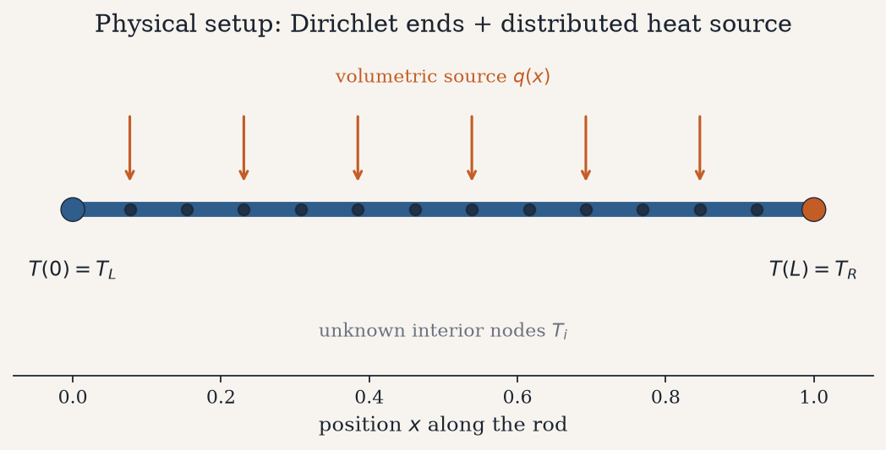
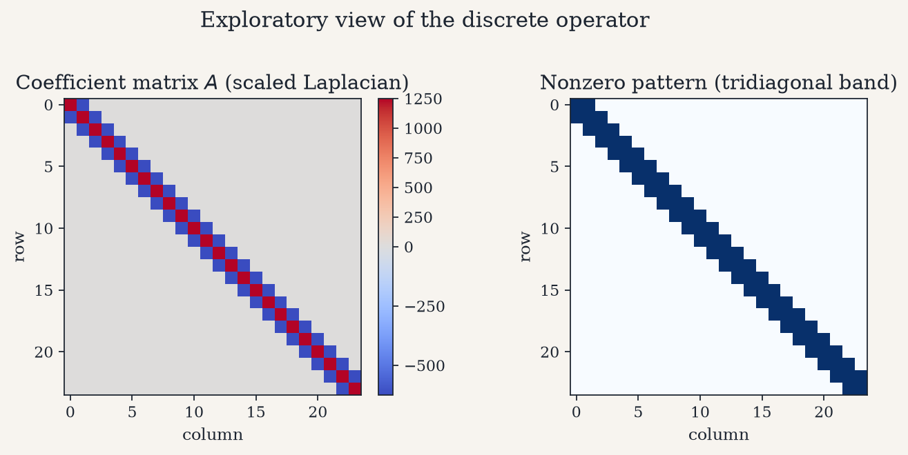
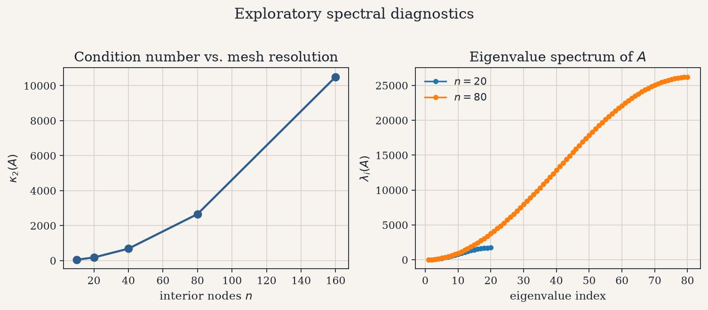
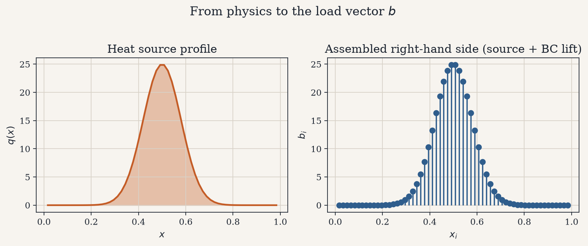
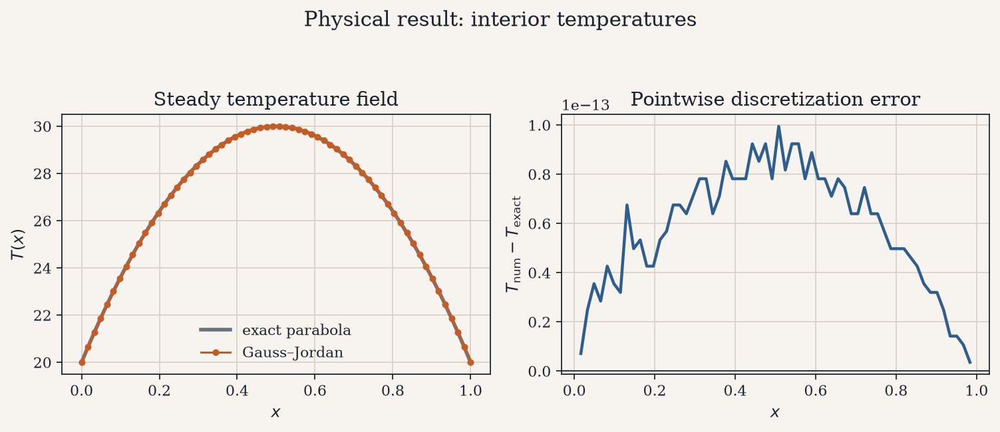
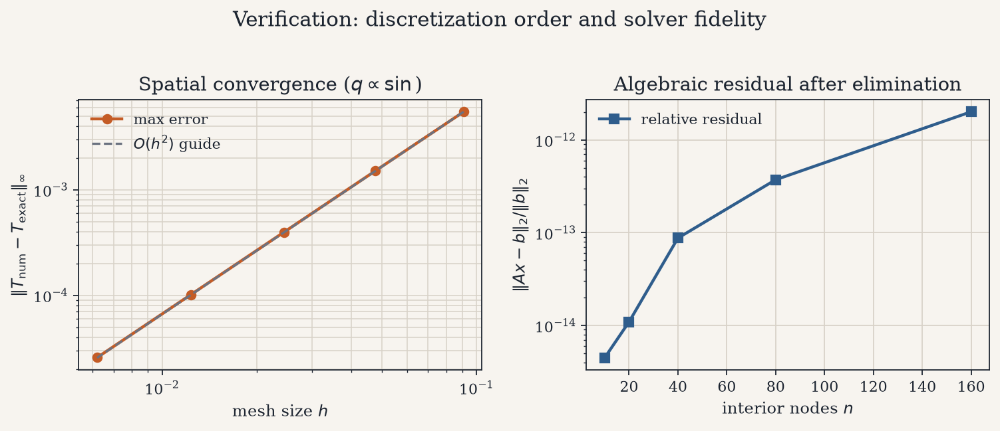

# Steady-State Heat Conduction via Gauss–Jordan Elimination

A conducting rod with fixed end temperatures and a distributed heat source
reaches a unique steady temperature field. Finite differences turn that
physics into a linear system $A\mathbf{T}=\mathbf{b}$; Gauss–Jordan
elimination with partial pivoting recovers $\mathbf{T}$.

<p align="center">
  
</p>

---

## 1. The physical problem

Consider a thin rod of length $L$ and conductivity $\kappa > 0$. In the
steady state the temperature $T(x)$ obeys

$$
-\kappa\, T''(x) = q(x), \qquad x \in (0,L),
$$

with Dirichlet data

$$
T(0)=T_L, \qquad T(L)=T_R.
$$

Here $q(x)$ is a volumetric heat source. The unknown of interest is the
interior temperature profile — how heat injected along the rod redistributes
until the ends’ fixed temperatures are compatible with a stationary balance.

<p align="center">
  
</p>

When $q(x)\equiv q_0$ is constant, the exact solution is the parabola

$$
T(x)=T_L+(T_R-T_L)\frac{x}{L}+\frac{q_0}{2\kappa}\,x(L-x).
$$

That closed form is the reference against which the discrete solve is judged
in the constant-source experiments below.

---

## 2. From continuum to linear algebra

Uniform nodes $x_i=ih$ with $h=L/(n+1)$ and the central second difference

$$
T''(x_i)\approx\frac{T_{i-1}-2T_i+T_{i+1}}{h^2}
$$

produce the discrete Laplacian system $A\mathbf{T}=\mathbf{b}$. The matrix
$A$ is symmetric, positive definite, and **tridiagonal** — nearest-neighbor
coupling only — while boundary temperatures enter exclusively through the
load vector $\mathbf{b}$:

$$
b_i=q(x_i)+\delta_{i1}\frac{\kappa T_L}{h^2}+\delta_{in}\frac{\kappa T_R}{h^2}.
$$

<p align="center">
  
</p>

The left panel shows the numerical entries of $A$ (positive diagonal,
negative off-diagonals). The right panel isolates the nonzero pattern: a
single band of width three. That structure is not an implementation
artifact — it is the discrete signature of a second-order local operator.

---

## 3. Exploratory diagnostics

Before solving, two spectral facts set expectations.

1. **Conditioning.** For this Laplacian, $\kappa_2(A)$ grows like $O(n^2)$
   as the mesh is refined. Finer grids resolve $T(x)$ better, but the linear
   system becomes progressively more sensitive.
2. **Spectrum.** All eigenvalues are positive; refining the mesh fills in
   the same spectral shape at higher index, consistent with a discrete
   second-derivative operator on a fixed interval.

<p align="center">
  
</p>

The load side of the story is equally concrete. A localized heater
$q(x)$ concentrates energy near mid-rod; after lifting the Dirichlet data,
the assembled $\mathbf{b}$ inherits that bump plus boundary corrections at
the first and last nodes.

<p align="center">
  
</p>

---

## 4. Solving $A\mathbf{T}=\mathbf{b}$ by Gauss–Jordan

Gauss–Jordan elimination transforms the augmented matrix $[A\mid\mathbf{b}]$
into reduced row echelon form $[I\mid\mathbf{T}]$:

1. **Partial pivoting** — at step $k$, swap in the largest available
   $|a_{pk}|$ with $p\ge k$.
2. **Normalize** the pivot row so $a_{kk}=1$.
3. **Eliminate** above and below, clearing column $k$.

When $A$ is nonsingular the last column is the unique discrete temperature
vector. The implementation lives in `gauss_jordan/` and is deliberately
agnostic of the heat model: any dense $A\mathbf{x}=\mathbf{b}$ follows the
same path.

---

## 5. Physical results

For a constant source the finite-difference stencil is **exact on
polynomials of degree ≤ 2**. Consequently the numerical profile overlays the
analytic parabola up to round-off; the pointwise difference fluctuates at
machine precision rather than at the level of truncation error.

<p align="center">
  
</p>

The left panel is the physical answer: with equal end temperatures, the
distributed source lifts a clear parabolic arch in the interior. The right
panel confirms that, for this particular $q$, disagreement with the continuum
solution is numerical noise — not modeling error.

---

## 6. Verification along two axes

To expose genuine discretization error, replace the constant source by

$$
q(x)=A\sin\!\left(\frac{\pi x}{L}\right),
$$

whose exact temperature is known in closed form. Refining $h$ then recovers
the expected **second-order** spatial convergence of central differences,
while the algebraic residual $\|\mathbf{r}\|_2/\|\mathbf{b}\|_2$ after
Gauss–Jordan stays near machine epsilon across all resolutions.

<p align="center">
  
</p>

| Check | Observation |
| --- | --- |
| Constant $q$ vs. parabola | Agreement to $\sim 10^{-13}$ (stencil exactness) |
| Sinusoidal $q$ vs. mesh size | Error slope matches $O(h^2)$ |
| Residual of $A\mathbf{T}-\mathbf{b}$ | $\sim 10^{-15}$ across tested $n$ |
| $\kappa_2(A)$ | Monotone growth with $n$, as predicted |

Together these checks separate **modeling error** (how well the grid
represents the PDE) from **solver fidelity** (how accurately elimination
satisfies the discrete equations).

---

## 7. Repository layout

```text
gauss_jordan/     # Gauss–Jordan solver + residual diagnostics
models/           # heat-rod assembly (physics → A, b)
scripts/          # figure generation and case-study runner
tests/            # solver and model tests
docs/             # mathematical formulation and architecture notes
figures/          # plots embedded above
```

Further detail: [mathematical formulation](docs/mathematical_formulation.md),
[architecture](docs/architecture.md).

---

## 8. Quick start

```bash
python -m venv .venv && source .venv/bin/activate
pip install -r requirements.txt

PYTHONPATH=. python scripts/run_case_study.py
PYTHONPATH=. python scripts/generate_figures.py
PYTHONPATH=. pytest tests -q
```

Example summary from the constant-source case ($n=40$, equal Dirichlet ends):

```text
condition κ₂(A)      : ~6.8e+02
relative residual    : ~1e-15
max error vs exact   : ~1e-13
```

---

## References

- Burden, R. L. & Faires, J. D. *Numerical Analysis* — Gauss–Jordan
  elimination and pivoting.
- LeVeque, R. J. *Finite Difference Methods for Ordinary and Partial
  Differential Equations* — second-difference Laplacians and $O(h^2)$
  accuracy.
- Strang, G. *Computational Science and Engineering* — discrete
  conservation and tridiagonal structure of 1-D diffusion.
