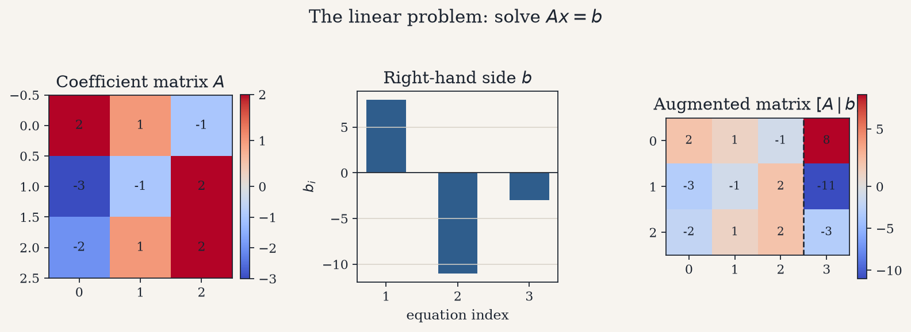
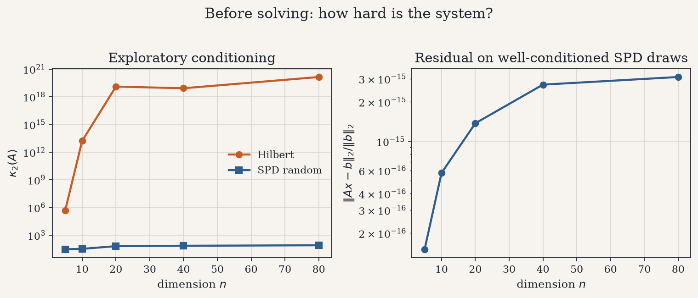
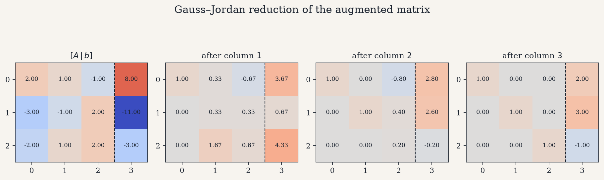
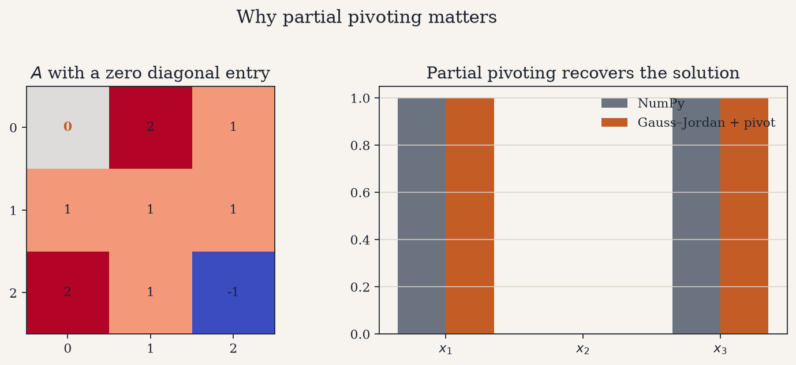
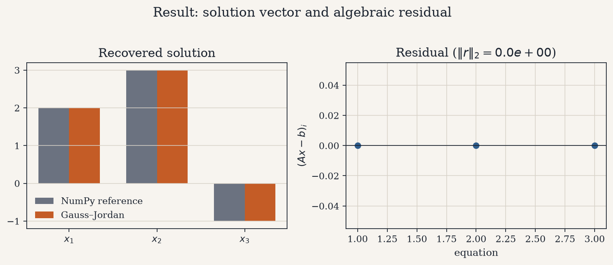
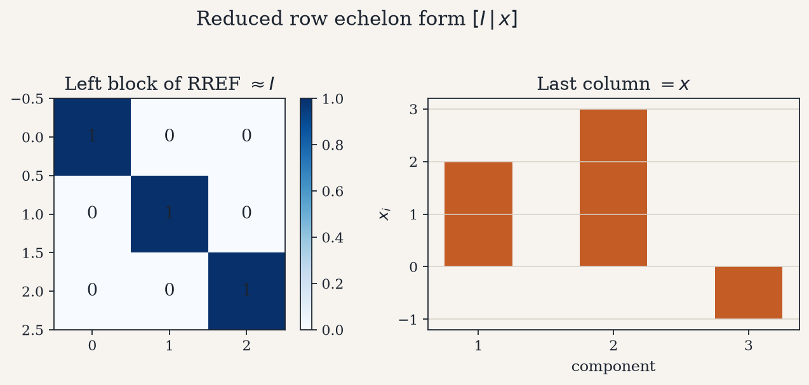

# Gauss–Jordan Elimination from Scratch

Solve a dense linear system $A x = b$ by transforming the augmented matrix
$[A \mid b]$ into reduced row echelon form $[I \mid x]$, implemented
explicitly with partial pivoting — no black-box linear solver on the critical
path.

<p align="center">
  
</p>

---

## 1. The problem

Given $A \in \mathbb{R}^{n \times n}$ nonsingular and $b \in \mathbb{R}^{n}$,
find the unique $x$ satisfying

$$
A x = b.
$$

The working object is the augmented matrix $[A \mid b]$. Elementary row
operations reduce it until the left block is the identity and the right block
is the solution.

<p align="center">
  
</p>

---

## 2. Exploratory view of the system

Before eliminating, two quantities set expectations:

- **Condition number** $\kappa_2(A)$ — how sensitive $x$ is to perturbations.
  Hilbert matrices blow up rapidly with $n$; well-conditioned SPD draws stay
  moderate.
- **Residual after a solve** on those SPD draws — a sanity check that the
  implementation closes $A x - b$ near machine precision when the system is
  reasonable.

<p align="center">
  
</p>

---

## 3. The elimination process

For each column $k = 1,\ldots,n$ the algorithm:

1. **partially pivots** — swaps in the largest available $|a_{ik}|$ with
   $i \ge k$;
2. **normalizes** the pivot row so the diagonal entry is $1$;
3. **eliminates** above and below, clearing column $k$.

The figure below shows a $3 \times 3$ system after each column is processed.
The dashed line separates $A$ from $b$; the final left block approaches $I$.

<p align="center">
  
</p>

---

## 4. Why partial pivoting matters

A nonsingular matrix can still have a zero on the diagonal. Naïve elimination
would divide by that entry and fail; partial pivoting swaps a nonzero row into
place and continues. The recovered $x$ then matches a reference dense solve.

<p align="center">
  
</p>

---

## 5. Result: solution and residual

Reading the last column of the RREF yields $x$. Comparing against
`numpy.linalg.solve` on the same system, and inspecting $r = A x - b$,
separates **solver fidelity** from any modeling concerns — here there is only
the linear algebra.

<p align="center">
  
</p>

<p align="center">
  
</p>

When $A$ is nonsingular, the left block of the RREF is $I$ and the right
block is exactly $x$.

| Check | Observation |
| --- | --- |
| Agreement with NumPy | Matching solution entries within tight tolerance |
| Relative residual $\|r\|_2/\|b\|_2$ | Near machine epsilon on well-conditioned tests |
| Zero-diagonal system | Solved correctly only with partial pivoting |
| Singular $A$ | Raises `LinAlgError` when no admissible pivot exists |

---

## 6. Repository layout

```text
gauss_jordan/     # from-scratch elimination + solve API
scripts/          # figure generation and case-study runner
tests/            # correctness, pivoting, step history
docs/             # mathematical formulation and architecture
figures/          # plots embedded above
```

Further detail: [mathematical formulation](docs/mathematical_formulation.md),
[architecture](docs/architecture.md).

---

## 7. Quick start

```bash
python -m venv .venv && source .venv/bin/activate
pip install -r requirements.txt

PYTHONPATH=. python scripts/run_case_study.py
PYTHONPATH=. python scripts/generate_figures.py
PYTHONPATH=. pytest tests -q
```

Example output on the $3 \times 3$ demo system:

```text
solution x           : [ 2.  3. -1.]
relative residual    : ~1e-16
```

---

## References

- Burden, R. L. & Faires, J. D. *Numerical Analysis* — Gauss–Jordan
  elimination and pivoting.
- Trefethen, L. N. & Bau, D. *Numerical Linear Algebra* — conditioning and
  stability of elimination.
- Strang, G. *Introduction to Linear Algebra* — reduced row echelon form and
  the meaning of $[I \mid x]$.
