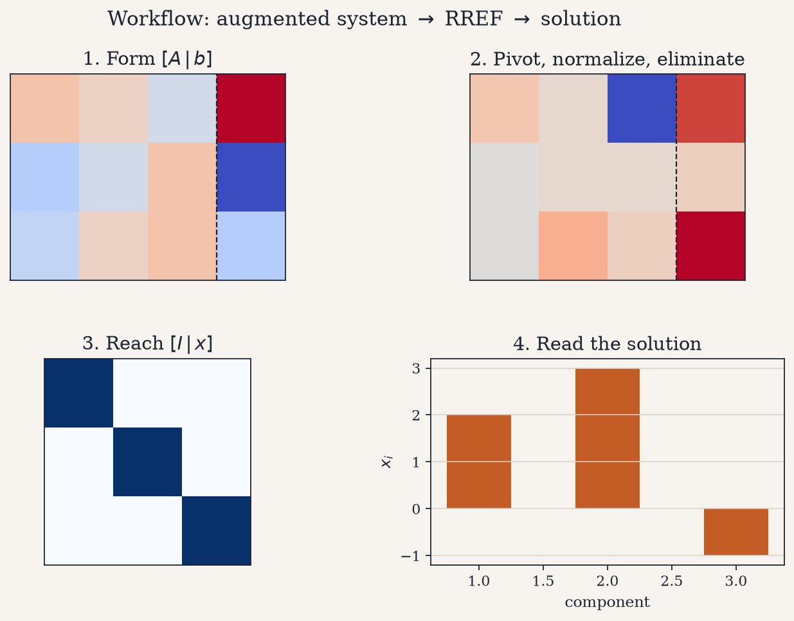
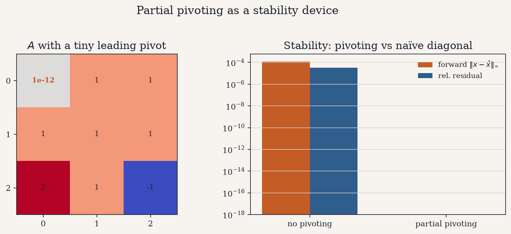
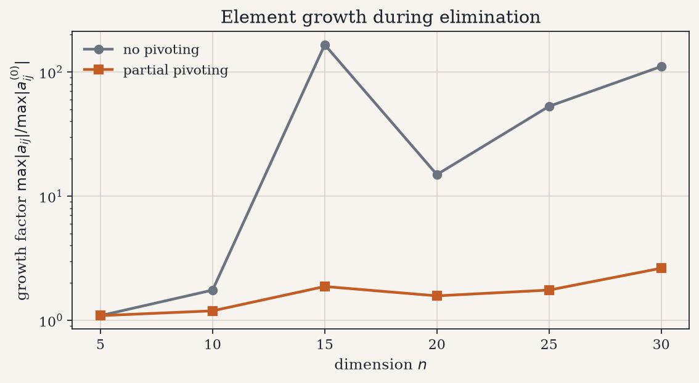
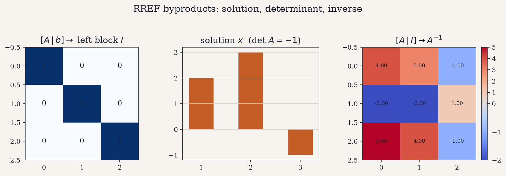
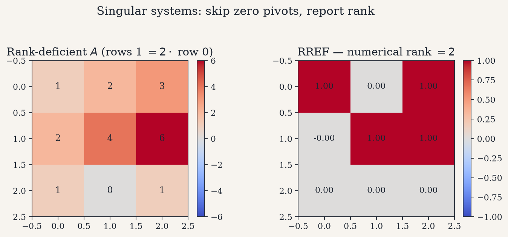
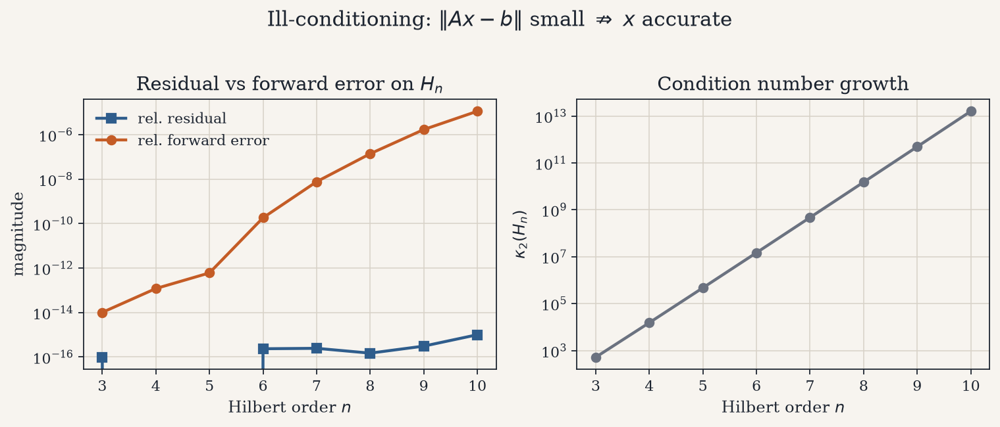
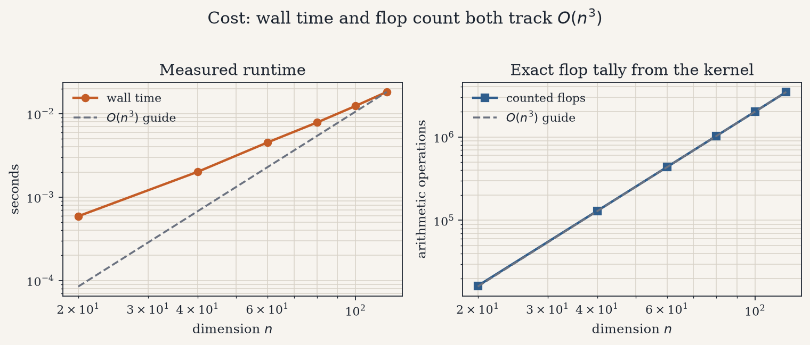

# Gauss–Jordan Elimination from Scratch

Solve a dense linear system $A x = b$ (or $A X = B$) by transforming the
augmented matrix $[A \mid b]$ into reduced row echelon form $[I \mid x]$,
implemented explicitly with partial pivoting — no black-box linear solver on
the critical path. The same reduction yields $\det(A)$ from the pivots,
$A^{-1}$ from $[A \mid I]$, the numerical rank, a growth factor, and an exact
flop count.

<p align="center">
  
</p>

---

## 1. The problem

Given $A \in \mathbb{R}^{n \times n}$ nonsingular and $b \in \mathbb{R}^{n}$,
find the unique $x$ satisfying

$$
A x = b.
$$

The working object is the augmented matrix $[A \mid b]$. Elementary row
operations reduce it until the left block is the identity and the right block
is the solution. Multiple right-hand sides $B \in \mathbb{R}^{n \times k}$
are reduced in a single pass as $[A \mid B] \to [I \mid X]$.

<p align="center">
  
</p>

---

## 2. Exploratory view of the system

Before eliminating, two quantities set expectations:

- **Condition number** $\kappa_2(A)$ — how sensitive $x$ is to perturbations.
  Hilbert matrices blow up rapidly with $n$; well-conditioned SPD draws stay
  moderate.
- **Residual after a solve** on those SPD draws — a sanity check that the
  implementation closes $A x - b$ near machine precision when the system is
  reasonable.

<p align="center">
  
</p>

---

## 3. The elimination process

For each admissible pivot column the algorithm:

1. **partially pivots** — swaps in the largest available $|a_{ik}|$ below the
   current row;
2. **normalizes** the pivot row so the pivot entry is $1$;
3. **eliminates** above and below, clearing that column.

The product of the pre-normalization pivots, times $(-1)^{n_{\mathrm{swaps}}}$,
is $\det(A)$ when $A$ has full rank.

<p align="center">
  
</p>

---

## 4. Partial pivoting as stability

A tiny leading pivot need not make $A$ singular, but dividing by it amplifies
round-off. On a system with $a_{11} = 10^{-12}$ and a known true $x$,
**partial pivoting** cuts the forward error by orders of magnitude relative to
naïve diagonal elimination — even when both runs report a small residual.

<p align="center">
  
</p>

The **growth factor**
$\max |a_{ij}| / \max |a_{ij}^{(0)}|$
tracks how large intermediate entries become. Partial pivoting keeps growth
under control on random nonsingular draws.

<p align="center">
  
</p>

---

## 5. Solution, residual, and RREF byproducts

Reading the last column of $[I \mid x]$ recovers the solution. Reducing
$[A \mid I]$ instead recovers $A^{-1}$. Both paths share the same elimination
kernel.

<p align="center">
  
</p>

<p align="center">
  
</p>

---

## 6. Rank-deficient systems

When a column has no admissible pivot, the full-rank solve path raises
`LinAlgError`. The RREF path instead **skips** that column, continues, and
reports the numerical rank (number of accepted pivots). For a matrix with a
repeated row, $\mathrm{rank}(A)=2 < 3$ and $\det(A)=0$.

<p align="center">
  
</p>

---

## 7. Ill-conditioning: residual is not forward error

On the Hilbert matrix $H_n$ with exact right-hand side $b = H_n\mathbf{1}$,
the relative residual can stay small while the relative forward error grows
with $\kappa_2(H_n)$. A trustworthy residual certifies that $Ax\approx b$; it
does **not** by itself certify that $x$ is close to the continuum truth when
$A$ is severely ill-conditioned.

<p align="center">
  
</p>

---

## 8. Computational cost

Dense Gauss–Jordan performs $\Theta(n^3)$ arithmetic. Wall-clock time and the
kernel’s exact flop counter both track an $O(n^3)$ guide line.

<p align="center">
  
</p>

| Check | Observation |
| --- | --- |
| Agreement with NumPy | Matching $x$ / $X$ on well-conditioned tests |
| Relative residual | Near machine epsilon when $\kappa_2(A)$ is moderate |
| Tiny leading pivot | Partial pivoting dominates naïve diagonal on forward error |
| Growth factor | Lower with partial pivoting on random draws |
| Hilbert $H_n$ | Residual stays small; forward error tracks $\kappa_2$ |
| Rank-deficient $A$ | RREF reports rank; $\det(A)=0$; solve raises |
| $\det(A)$, $A^{-1}$ | Match `numpy.linalg` on nonsingular draws |
| Flop count | Scales cubically with $n$ |

---

## 9. Repository layout

```text
gauss_jordan/     # elimination kernel, invert, rank, determinant, solve API
scripts/          # figure generation and case-study runner
tests/            # correctness, pivoting, rank, multi-RHS, flops
docs/             # mathematical formulation and architecture
figures/          # plots embedded above
```

Further detail: [mathematical formulation](docs/mathematical_formulation.md),
[architecture](docs/architecture.md).

---

## 10. Quick start

```bash
python -m venv .venv && source .venv/bin/activate
pip install -r requirements.txt

PYTHONPATH=. python scripts/run_case_study.py
PYTHONPATH=. python scripts/generate_figures.py
PYTHONPATH=. pytest tests -q
```

Example output on the $3 \times 3$ demo system:

```text
solution x           : [ 2.  3. -1.]
det(A)               : -1
rank(A)              : 3
relative residual    : ~1e-16
```

---

## References

- Burden, R. L. & Faires, J. D. *Numerical Analysis* — Gauss–Jordan
  elimination and pivoting.
- Trefethen, L. N. & Bau, D. *Numerical Linear Algebra* — conditioning,
  residual vs forward error, growth factors, stability of elimination.
- Strang, G. *Introduction to Linear Algebra* — reduced row echelon form,
  rank, and the meaning of $[I \mid x]$.
